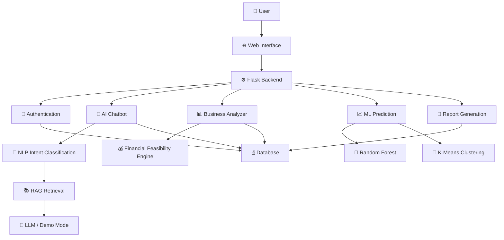

<div align="center">


<a href="https://readme-typing-svg.demolab.com">

</a>

<br/>

### 🚀 From Business Ideas to Data-Driven Decisions

**An AI-powered virtual business advisor built for entrepreneurs, startup founders, and aspiring business owners.**

<br/>

<a href="https://ai-business-assistant-lilac.vercel.app/">

</a>
<a href="https://github.com/shravan-kumar-42/ai-business-assistant">

</a>

<br/><br/>


</div>

---

## 🧠 About the Project

**AI-Powered Business Entrepreneur Assistant** is a final-year B.E./B.Tech Artificial Intelligence and Machine Learning major project designed to help entrepreneurs make smarter business decisions.

Instead of functioning as just another chatbot, this application combines **Generative AI, Retrieval-Augmented Generation (RAG), Natural Language Processing, and Machine Learning** to provide structured business insights.

Users can explore business ideas, analyze financial feasibility, estimate business risks, understand customer segments, generate business plans, and interact with an AI-powered business advisor.

The application also includes a Demo Mode, allowing its core features to be demonstrated without requiring an external LLM API key.

---

## 🌐 Live Application

<div align="center">

### Experience the AI Business Assistant

<a href="https://ai-business-assistant-lilac.vercel.app/">

</a>

**Deployed using Vercel | Database hosted on Neon PostgreSQL**

</div>

---

## ✨ Key Features

### 📊 1. Intelligent Business Decision Support

| Feature | Description |
|---|---|
| Business Analyzer | Evaluates financial feasibility, profitability, ROI, and break-even |
| Business Health Score | Generates a weighted business score from 0–100 |
| Risk Prediction | Predicts business risk as Low, Medium, or High |
| Risk Factor Explanation | Identifies influential business inputs using model feature importance |
| What-If Simulator | Dynamically recalculates financial outcomes when business assumptions change |
| Business Idea Generator | Generates and scores business ideas using a trained ML model |
| Competitor Analysis | Compares competitors and identifies differentiation opportunities |
| My Businesses | Saves and manages individual business analyses |

### 🤖 2. AI & NLP Capabilities

- AI-powered chatbot with structured business responses.
- Retrieval-Augmented Generation (RAG) using a curated business knowledge base.
- TF-IDF vectorization and cosine similarity for document retrieval.
- Source document references for retrieved knowledge.
- NLP-based intent classification across eight business categories.
- Context-aware responses using saved business profiles.
- Pluggable OpenAI-compatible LLM API integration.
- Demo Mode with template-based response generation.

### 📈 3. Machine Learning

| Model / Technique | Application |
|---|---|
| Random Forest | Business Risk Prediction |
| K-Means Clustering | Customer Segmentation |
| TF-IDF | Knowledge Base Vectorization |
| Cosine Similarity | Relevant Document Retrieval |
| Feature Importance | Risk Factor Explanation |

### 🛠️ 4. Additional Features

- User registration, login, and logout.
- Secure password hashing and session management.
- Business Plan Generator with 10 sections.
- Market Analysis tool.
- Interactive analytics dashboard.
- Chart.js visualizations.
- Conversation history management.
- PDF report generation.
- Excel report export.
- Demo Mode for demonstrations without an external LLM API.

---

## 🏗️ System Architecture



---

## 💻 Technology Stack

| Category | Technologies |
|---|---|
| Programming Language | Python |
| Frontend | HTML5, CSS3, Bootstrap 5, JavaScript |
| Backend | Flask |
| Database | MySQL 8.0 |
| ORM | SQLAlchemy, Flask-SQLAlchemy |
| Artificial Intelligence | Generative AI, LLM Integration |
| NLP | Custom Intent Classification |
| RAG | TF-IDF, Cosine Similarity |
| Machine Learning | Scikit-learn, Random Forest, K-Means |
| Data Processing | NumPy, Pandas |
| Visualization | Chart.js |
| PDF Generation | ReportLab |
| Excel Generation | OpenPyXL |
| Deployment | Vercel |
| Version Control | Git and GitHub |

---

## 📂 Project Structure

```text
ai-business-assistant/
│
├── app.py
├── config.py
├── requirements.txt
├── .env.example
│
├── database/
│   ├── models
│   └── initialization
│
├── routes/
│   ├── authentication
│   ├── dashboard
│   ├── chatbot
│   ├── business
│   ├── prediction
│   └── reports
│
├── ai/
│   ├── nlp.py
│   ├── rag.py
│   ├── llm.py
│   └── prompt templates
│
├── ml/
│   ├── train_model.py
│   ├── predict.py
│   ├── segmentation.py
│   └── preprocessing
│
├── data/
│   ├── business_dataset.csv
│   └── customer_dataset.csv
│
├── knowledge_base/
│
├── templates/
│
├── static/
│   ├── css/
│   └── js/
│
├── reports/
│
├── tests/
│
├── DIAGRAMS.md
├── ACADEMIC_DOCUMENTATION.md
└── VIVA_QUESTIONS.md
```

---

## ⚙️ Installation and Setup

### Prerequisites

- Python 3.10+
- Git
- VS Code (recommended)

### 1. Clone the repository

```bash
git clone https://github.com/shravan-kumar-42/ai-business-assistant.git

cd ai-business-assistant
```

### 2. Create a virtual environment

```bash
python -m venv venv
```

Activate it on Windows:

```powershell
venv\Scripts\activate
```

### 3. Install dependencies

```bash
pip install -r requirements.txt
```

### 4. Configure environment variables

Create your local environment file:

```powershell
copy .env.example .env
```

Configure the required variables in `.env`.

Keep your API keys and database credentials private. Never commit your actual `.env` file.

Leave `LLM_API_KEY` empty to use Demo Mode, or configure a valid OpenAI-compatible API key for live LLM responses.

### 5. Train the Machine Learning model

```bash
python ml/train_model.py
```

This trains the Random Forest model using the provided synthetic business dataset.

### 6. Run the application

```bash
python app.py
```

Open your browser:

```text
http://127.0.0.1:5000
```

### 7. Run tests (optional)

```bash
pip install pytest
pytest tests/
```

---

## 🧪 Demo Mode

The application supports Demo Mode when no LLM API key is configured.

In this mode:

- The chatbot uses structured template-based responses.
- NLP intent classification continues to work.
- RAG document retrieval continues to work.
- Business Plan Generator uses built-in templates.
- Market Analysis uses built-in templates.
- Random Forest risk prediction remains available.
- K-Means customer segmentation remains available.

**Note:** Demo Mode replaces the final LLM response-generation step. It does not disable the underlying NLP, retrieval, or ML functionality.

---

## 📡 API / Route Reference

| Method | Endpoint | Description |
|---|---|---|
| GET/POST | `/register` | User registration |
| GET/POST | `/login` | User login |
| GET | `/logout` | User logout |
| GET | `/dashboard` | Main dashboard |
| GET/POST | `/chat` | AI chatbot |
| POST | `/chat/new` | New conversation |
| GET | `/history` | Conversation history |
| GET/POST | `/business-plan` | Business plan generation |
| POST | `/business-plan/save` | Save business plan |
| GET/POST | `/market-analysis` | Market analysis |
| GET/POST | `/prediction` | ML risk prediction |
| GET/POST | `/business-analyzer` | Business feasibility analysis |
| GET | `/my-businesses` | Saved business profiles |
| GET/POST | `/idea-generator` | Business idea generation |
| GET/POST | `/competitor-analysis` | Competitor analysis |
| GET | `/analytics` | Analytics dashboard |
| GET | `/reports` | Reports dashboard |
| GET | `/reports/pdf` | PDF export |
| GET | `/reports/excel` | Excel export |

---

## 📊 Dataset Disclaimer

The business and customer datasets included in this project are synthetically generated for academic and demonstration purposes.

Machine Learning evaluation metrics reflect performance on the provided synthetic datasets and should not be interpreted as evidence of real-world predictive accuracy.

---

## 🔮 Future Enhancements

- Integrate vector databases such as FAISS or ChromaDB for scalable RAG retrieval.
- Introduce real-time market data integration.
- Add multilingual AI chatbot support.
- Explore XGBoost for advanced business risk prediction.
- Develop a separate mobile application with API authentication.
- Improve business recommendations using additional real-world datasets.

---

## 📚 Project Documentation

Additional academic documentation is available in the repository:

| Document | Description |
|---|---|
| `ACADEMIC_DOCUMENTATION.md` | Complete academic project report |
| `DIAGRAMS.md` | Architecture, data flow, ER, RAG, and ML diagrams |
| `VIVA_QUESTIONS.md` | Prepared project viva questions and answers |

---
## 👨‍💻 Project Team

<div align="center">

### 🤝 Team Members

**1. Harshal Gowda L**  
**2. Sanjan Kumar S K**  
**3. Shravan Kumar G**  
**4. Suman K**

**B.E. – Artificial Intelligence & Machine Learning**  
KNS Institute of Technology

<br/>

<a href="https://github.com/shravan-kumar-42">

</a>

<a href="https://www.linkedin.com/in/shravan-kumar-g-111720306/">

</a>

</div>

---

<div align="center">

### 💡 Turning Ideas Into Intelligent Decisions

**Built with Python, Artificial Intelligence, Machine Learning, and a passion for innovation.**


</div>